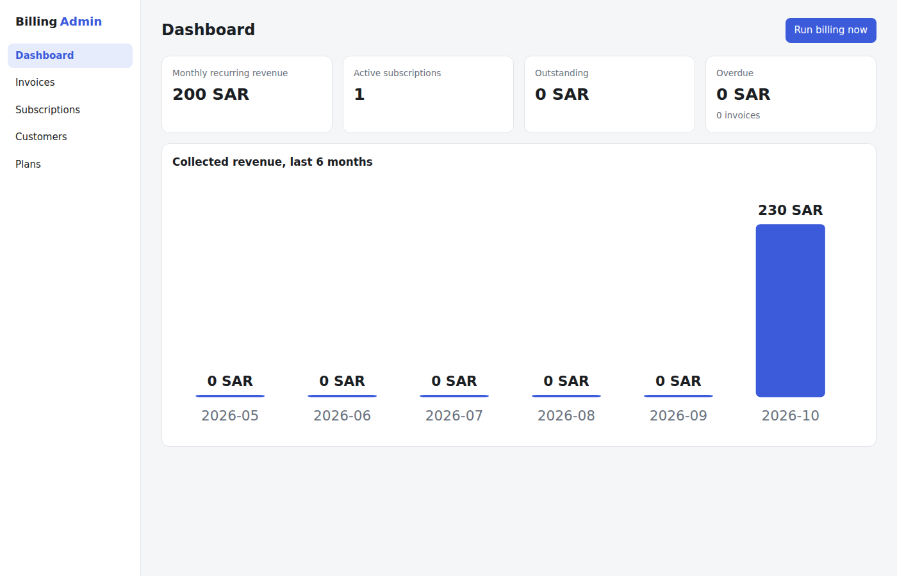
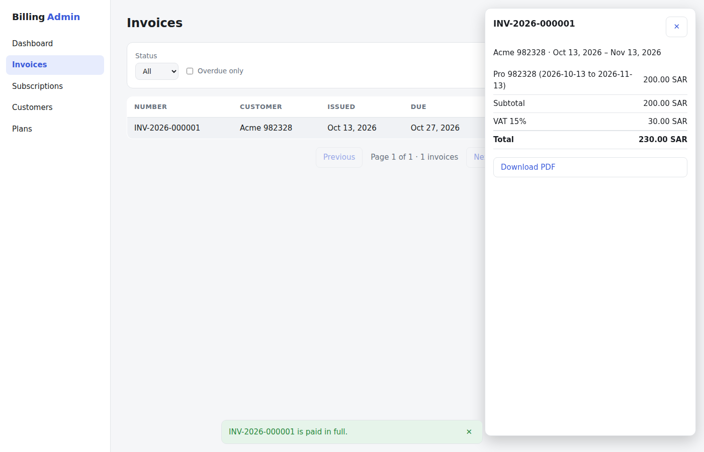

# Billing Admin Dashboard

[](https://github.com/Al7assan1999/billing-admin-dashboard/actions/workflows/ci.yml)

An **Angular 22** admin UI for the [billing-service](https://github.com/Al7assan1999/billing-service) API: track recurring revenue, manage plans, customers and subscriptions, and work the invoice queue (filter, inspect, record payments, download PDFs).




*Screenshots are taken by the end-to-end test in CI, running against the real API.*

## Highlights

- **Signals throughout**: state is `signal`/`computed`; reads use **`httpResource`**, so changing the invoice filter signal re-fetches automatically and cancels the stale request.
- **Standalone components and lazy routes**: each page is its own chunk; the first load ships only the shell and the dashboard.
- **Reactive forms** with validation for customers, plans and subscriptions.
- **Central error handling**: an HTTP interceptor turns ASP.NET problem details (including validation error maps) into readable toasts.
- **No chart library**: the revenue chart is a small SVG bound to a `computed` signal.
- **Accessible by default**: labelled controls, keyboard-reachable actions, `aria-live` toasts, and light/dark themes from `prefers-color-scheme`.

## Structure

```
src/app/
  core/
    billing-api.ts        URL builders for httpResource + write methods
    models.ts             API types
    error.interceptor.ts  problem details → toast
    toast.ts              toast service + host component
    money.pipe.ts         "1,234.50 SAR" formatting
  features/
    dashboard.ts          KPIs + revenue chart, manual billing run
    invoices.ts           filters, paging, detail drawer, payments, PDF
    subscriptions.ts      start, change plan (prorated), cancel
    customers.ts, plans.ts
e2e/billing.e2e.ts        Playwright: full admin workflow against the real API
```

## Running locally

Start the API first (from the billing-service repo):

```bash
docker compose up --build        # API on http://localhost:5200
```

Then the dashboard:

```bash
npm install
npm start                        # http://localhost:4200, proxies /api to :5200
```

## Tests

| Suite | Tool | What it covers |
|---|---|---|
| Unit | Vitest (`ng test`) | Query building, problem-details parsing, dashboard rendering and invoice filtering with `HttpTestingController` |
| End-to-end | Playwright | Create a plan and customer, start a subscription, find the invoice, record payment, check the dashboard |

In CI the end-to-end job checks out **billing-service**, starts it with Docker Compose (SQL Server + API), and runs Playwright against it, so the UI is verified against the real backend on every push.

```bash
npm test                 # unit tests
npx playwright test      # e2e (needs the API running on :5200)
```

## License

MIT
